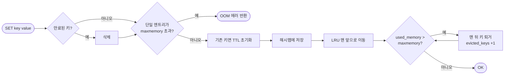
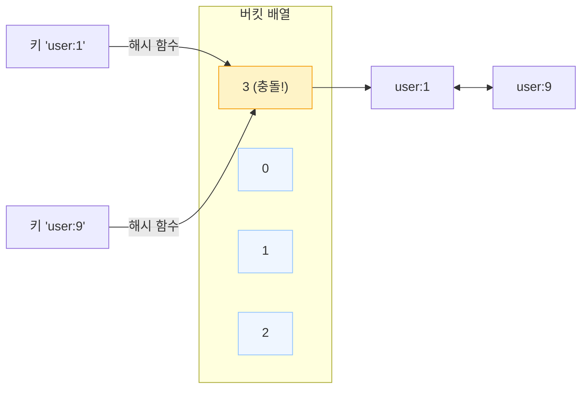

<p align="center">
  
</p>

<p align="center">
  
  
  
  
</p>

<p align="center">
  <b>Redis는 왜 빠를까?</b> 내부 자료구조를 밑바닥부터 직접 만들어서 확인해 봅니다.<br>
  <sub>해시맵 · 이중 연결 리스트 · 최소 힙으로 만든 CLI 인메모리 Key-Value 저장소</sub>
</p>

<p align="center">
  <a href="https://nick19850906-debug.github.io/5-1-Mini-Redis/"><b>▶ 인터랙티브 데모 열기</b></a>
  &nbsp;·&nbsp;
  <a href="#-30초-실행-가이드">30초 실행</a>
  &nbsp;·&nbsp;
  <a href="#-동료-평가자-체크리스트">평가 체크리스트</a>
  &nbsp;·&nbsp;
  <a href="#-핵심-원리-qa">핵심 원리 Q&A</a>
</p>

---

## 🧭 한눈에 보기

| | 내용 |
| :--- | :--- |
| 🎯 **목표** | `SET/GET/DEL…` 10개 명령어, **LRU 자동 퇴거**, **TTL 만료**를 직접 구현 |
| 🧱 **직접 만든 것** | 이중 연결 리스트 · 해시맵(체이닝) · 최소 힙 |
| 🚫 **쓰지 않은 것** | `dict`, `set`, `collections` (AST 검사로 자동 확인) |
| ⚡ **핵심 성능** | 조회·삽입·삭제 평균 **O(1)**, LRU 갱신 **O(1)**, 만료 확인 **O(1)** (`peek`) |
| 📂 **코드 위치** | [`mini_redis/`](./mini_redis) |

---

## 🏗️ 구조: 3개의 자료구조가 한 팀으로 일한다

<p align="center"></p>

> **역할 분담** — 🟦 해시맵은 "키로 바로 찾기", 🟩 이중 연결 리스트는 "누가 오래됐는지 줄 세우기", 🟨 최소 힙은 "누가 먼저 만료되는지 알기".
> 해시맵의 `Record` 가 리스트 노드를 **직접 들고 있어서**, 키만 알면 순서 변경까지 한 번에 끝납니다.

### `SET` 한 번에 일어나는 일



---

## 🎞️ 애니메이션으로 보는 LRU 퇴거

<p align="center"></p>

명세서 예시 그대로입니다. `maxmemory 30` 에서 `user:3` 을 넣는 순간 33바이트가 되어, 가장 오래 쓰지 않은 `user:1` 이 O(1)로 빠집니다.

---

## ⏱️ 왜 TTL에는 "최소 힙"일까?

<p align="center"></p>

전체 키를 매번 훑으면 O(N), 힙은 **맨 위(`peek`) 하나만 보면** 만료 대상이 있는지 알 수 있습니다.
`DEL` 이나 덮어쓰기로 무효가 된 항목은 힙에서 억지로 지우지 않고, 꺼낼 때 실제 만료 시각과 비교해 버리는 **지연 삭제(lazy deletion)** 를 씁니다.

### 해시 충돌은 이렇게 해결합니다



같은 칸에 걸리면 **이중 연결 리스트로 이어 붙이고(체이닝)**, `키 개수 ÷ 버킷 수 > 0.75` 가 되면 **버킷을 2배**로 늘려 전부 다시 배치합니다.

---

## 🚀 30초 실행 가이드

```bash
git clone https://github.com/nick19850906-debug/5-1-Mini-Redis.git
cd 5-1-Mini-Redis/mini_redis
python main.py          # CLI 실행 (exit / quit 으로 종료)
python evaluate.py      # 자동 점검 (약 1초 대기 포함)
```

Python 3.8+ 만 있으면 되고, 설치할 라이브러리는 없습니다.

<details>
<summary><b>💻 실행 예시 (명세서 시나리오)</b></summary>

```text
mini-redis> CONFIG SET maxmemory 30
OK
mini-redis> SET user:1 "Alice"
OK
mini-redis> SET user:2 "Bob"
OK
mini-redis> SET user:3 "Charlie"
OK
mini-redis> GET user:1
(nil)
mini-redis> INFO memory
used_memory:22
maxmemory:30
evicted_keys:1
mini-redis> KEYS
1. "user:2"
2. "user:3"
mini-redis> EXPIRE user:2 3
(integer) 1
mini-redis> TTL user:2
(integer) 3
```

`TTL` 은 남은 시간을 **올림**해서 보여 주므로 설정 직후엔 `3` 입니다. (명세서의 `2` 는 참고용 예시)

</details>

---

## 📋 지원 명령어

| 구분 | 명령어 | 설명 |
| :--- | :--- | :--- |
| String | `SET key value` | 저장 + LRU 갱신. 덮어쓰면 **기존 TTL 초기화** |
| String | `GET key` | 조회. **성공할 때만** LRU 갱신, 만료 키는 삭제 후 `(nil)` |
| String | `DEL key` | 해시맵 · LRU · 메모리에서 완전 삭제 (`1`/`0`) |
| String | `EXISTS key` | 존재 여부 (`1`/`0`) |
| String | `DBSIZE` | 유효한 키 개수 |
| String | `KEYS` | 전체 키 목록 (패턴 없음) |
| 메모리 | `CONFIG SET maxmemory bytes` | 최대 메모리 (0 = 무제한) |
| 메모리 | `INFO memory` | `used_memory` · `maxmemory` · `evicted_keys` |
| TTL | `EXPIRE key seconds` | 만료 설정 (0 이하는 즉시 만료) |
| TTL | `TTL key` | 남은 초 (`-2` 없음, `-1` 만료 없음) |

`used_memory = Σ ( len(utf8(key)) + len(utf8(value)) )` — 자료구조 오버헤드는 계산하지 않습니다.

---

## ✅ 동료 평가자 체크리스트

`python evaluate.py` 한 번이면 아래가 자동 점검됩니다. 직접 확인하려면 오른쪽 방법을 따르세요.

| # | 평가 항목 | 직접 확인 |
| :-: | :--- | :--- |
| 1 | `dict` / `set` / `collections` 미사용 | 5개 `.py` 에서 키워드 검색 |
| 2 | 이중 연결 리스트 6개 메서드 O(1) | [`doubly_linked_list.py`](./mini_redis/doubly_linked_list.py) |
| 3 | 자체 해시 함수 · 체이닝 · 0.75 초과 시 2배 확장 | [`hash_map.py`](./mini_redis/hash_map.py) `_hash` `_resize` |
| 4 | 최소 힙 `push/pop/peek/size` · `_heapify_up/down` | [`min_heap.py`](./mini_redis/min_heap.py) |
| 5 | 명세서 예시 재현 (LRU 퇴거 + `INFO memory`) | 위 실행 예시 |
| 6 | `GET` 시 LRU 갱신 · 단일 엔트리 OOM | `maxmemory 30` 후 큰 값 `SET` |
| 7 | TTL 만료 · 덮어쓰기 시 TTL 초기화 | `EXPIRE` → 대기 → `GET`/`TTL` |
| 8 | 표준 에러 4종 | `GET` · `HELLO` · `CONFIG SET maxmemory abc` |
| 9 | 자료구조 독립 파일 · docstring | [`mini_redis/`](./mini_redis) 구조 확인 |

---

## 🎓 핵심 원리 Q&A

<details>
<summary><b>Q1. 해시 함수와 충돌 해결은 어떻게 구현했나요?</b></summary>

[`_hash`](./mini_redis/hash_map.py) 는 각 문자의 `ord` 에 소수 **31** 을 곱해 누적하고 버킷 수로 나눈 나머지를 쓰는 **다항식 롤링 해시**입니다. 같은 버킷에 걸리면 직접 만든 `DoublyLinkedList` 에 이어 붙이는 **체이닝**으로 해결합니다. 로드팩터가 0.75를 넘으면 버킷을 2배로 늘리고 전부 재해싱합니다(`_resize`).
</details>

<details>
<summary><b>Q2. 이중 연결 리스트 + 해시맵으로 O(1) LRU가 되는 이유는?</b></summary>

리스트만 쓰면 특정 키의 위치를 찾느라 O(N)입니다. 그래서 해시맵의 `Record` 가 **리스트 노드(`lru_node`)를 직접 보관**합니다. `GET`/`SET` 시 해시맵으로 노드를 O(1)에 찾고, `move_to_front` 가 앞뒤 포인터만 바꿔 맨 앞으로 옮깁니다. 퇴거 대상은 항상 `tail.prev` 라 O(1)입니다. 양 끝의 더미(sentinel) 노드 덕분에 빈 리스트나 끝 노드도 같은 코드로 처리됩니다.
</details>

<details>
<summary><b>Q3. 최소 힙이 TTL 관리에 적합한 이유는?</b></summary>

루트에 가장 빨리 만료될 `(expire_at, key)` 가 있어 `peek` 한 번(O(1))으로 만료 대상 유무를 알 수 있고, `push`/`pop` 은 O(log N)입니다. 무효가 된 항목은 루트에서 꺼낼 때 실제 `Record.expire_at` 과 대조해 버리는 **지연 삭제**로 처리합니다.
</details>

<details>
<summary><b>Q4. 메모리 제한 시 LRU 퇴거와 <code>used_memory</code> 갱신 흐름은?</b></summary>

`used_memory` 는 추가·삭제 때마다 `len(utf8(key)) + len(utf8(value))` 만큼 증감합니다. `SET` 에서 예상 메모리가 `maxmemory` 를 넘으면 `tail.prev` 의 가장 오래된 키부터 하나씩 지우고 `evicted_keys` 를 1씩 올립니다. 단일 엔트리 자체가 `maxmemory` 보다 크면 기존 데이터를 지우지 않고 곧바로 OOM 에러를 반환합니다.
</details>

---

## 📁 저장소 구조

```text
5-1-Mini-Redis/
├── README.md                      # 지금 보고 있는 페이지
├── assets/                        # README용 애니메이션 SVG
│   ├── banner.svg
│   ├── architecture.svg
│   ├── lru-flow.svg
│   └── ttl-heap.svg
├── docs/
│   └── index.html                 # 인터랙티브 데모 (GitHub Pages)
└── mini_redis/
    ├── doubly_linked_list.py      # O(1) 이중 연결 리스트
    ├── hash_map.py                # 다항식 롤링 해시 + 체이닝 해시맵
    ├── min_heap.py                # TTL용 배열 기반 최소 힙
    ├── mini_redis.py              # 코어 엔진 (명령어 · LRU · TTL · 메모리)
    ├── main.py                    # CLI REPL + 파서
    ├── evaluate.py                # 동료 평가용 자동 점검
    └── README.md                  # 코드 폴더 상세 문서
```

<p align="center"><sub>Made for peer review · 5-1- Mini Redis</sub></p>
