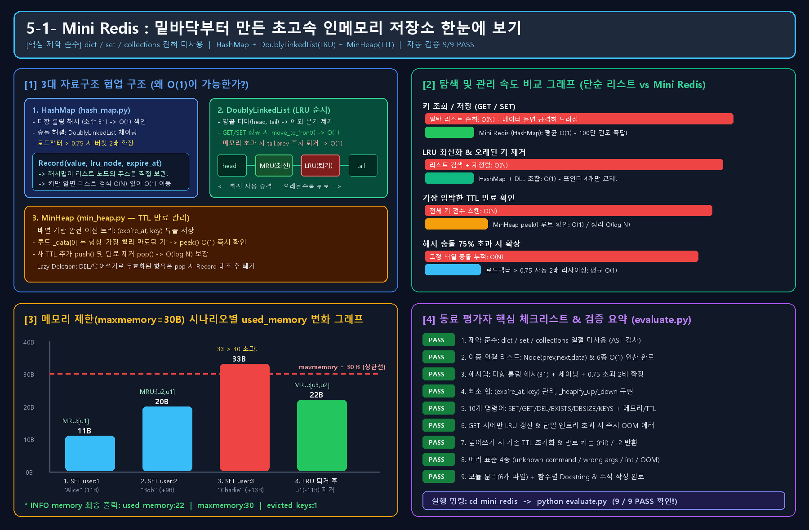
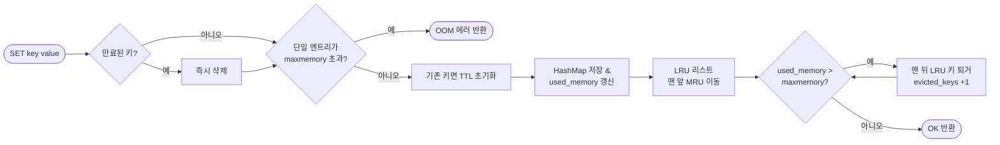
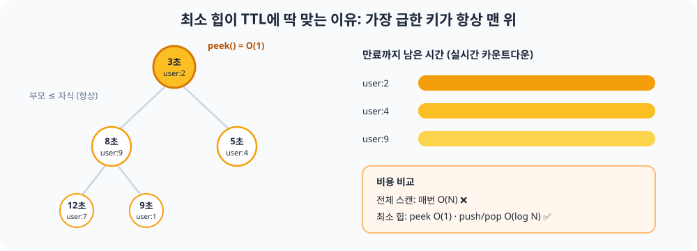
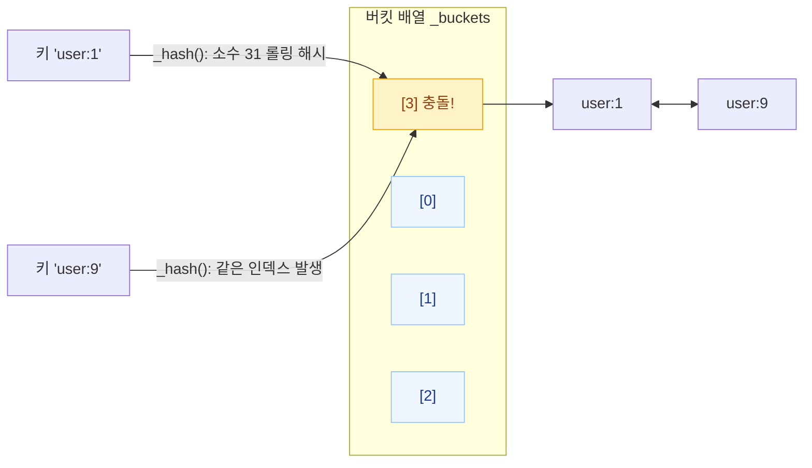

<p align="center">
  
</p>

# 5-1- Mini Redis — 정보를 엄청 빠르게 찾아주는 작은 저장소

<p align="center">
  
  
  
  
</p>

<p align="center">
  <b>"Redis는 왜 이렇게 빠를까?"</b><br>
  파이썬 내장 <code>dict</code>, <code>set</code>, <code>collections</code>를 전혀 쓰지 않고 <b>해시맵 · 이중 연결 리스트 · 최소 힙</b>을 밑바닥부터 직접 구현해<br>
  <b>O(1) 조회 · O(1) LRU 자동 퇴거 · 힙 기반 TTL 만료</b>를 완성한 CLI 인메모리 Key-Value 저장소입니다.
</p>

<p align="center">
  <a href="https://nick19850906-debug.github.io/5-1-Mini-Redis/">
    
  </a>
  &nbsp;
  <a href="#-동료-평가자-1분-검증-가이드">
    
  </a>
</p>

> 💡 **동료 평가자분들을 위한 체험 팁:** 위 **[▶ 인터랙티브 HTML 애니메이션 데모 열기](https://nick19850906-debug.github.io/5-1-Mini-Redis/)** 를 누르시면, 브라우저에서 직접 `SET`, `GET`, `EXPIRE`, `CONFIG SET maxmemory 30` 명령어를 누르며 **메모리 게이지 · LRU 리스트 · 해시맵 버킷 충돌 · TTL 카운트다운 힙**이 실시간으로 움직이는 모습을 바로 확인하실 수 있습니다! (로컬 파일: [`docs/index.html`](./docs/index.html))

---

## 📊 1. 한눈에 보는 종합 인포그래픽 & 성능 비교

<p align="center">
  
</p>

| 핵심 목표 | 직접 구현한 자료구조 | 시간 복잡도 | 비전공자 한 줄 요약 |
| :--- | :--- | :---: | :--- |
| **초고속 키 검색·저장** | [`HashMap`](./mini_redis/hash_map.py) (체이닝 + 0.75 확장) | **평균 $O(1)$** | 이름(`key`)만 넣으면 우편함 번호를 즉시 계산해 한 번에 찾음 |
| **최근/오래된 키 추적** | [`DoublyLinkedList`](./mini_redis/doubly_linked_list.py) + `Record.lru_node` | **완전 $O(1)$** | 해시맵이 기차 칸 주소를 기억해, 줄 전체를 안 뒤지고 앞뒤 고리만 교체 |
| **가장 빠른 만료 키 찾기** | [`MinHeap`](./mini_redis/min_heap.py) (배열 기반 최소 힙) | **`peek` $O(1)$ / $O(\log N)$** | 유통기한이 가장 짧은 키가 항상 꼭대기(`0`번)에 있어 즉각 확인 |

---

## 🏗️ 2. 전체 아키텍처 & 동작 애니메이션

### ① 세 자료구조가 한 팀으로 일하는 구조
<p align="center">
  
</p>

### ② `SET` 명령어 1회 실행 시 내부 처리 흐름


---

## 🎞️ 3. 메모리 제한 LRU 자동 퇴거 애니메이션 (`maxmemory = 30B`)

<p align="center">
  
</p>

- **공식:** `used_memory = Σ ( len(utf8(key)) + len(utf8(value)) )` *(노드·포인터 등 자료구조 오버헤드 제외)*
- **단일 엔트리 OOM 방어:** 새로운 `(key + value)` 하나만의 바이트가 `maxmemory`를 넘으면 기존 데이터를 지우지 않고 `(error) OOM command not allowed when used_memory > 'maxmemory'`를 즉시 반환합니다.

---

## ⏱️ 4. 왜 TTL 만료 관리에는 '최소 힙'일까?

<p align="center">
  
</p>

### 📮 해시 충돌 해결(체이닝) & 0.75 로드팩터 2배 확장 원리

- 같은 버킷 번호로 해싱되더라도 직접 구현한 **이중 연결 리스트(`DoublyLinkedList`)** 로 줄줄이 연결(체이닝)해 데이터를 잃지 않습니다.
- `(저장된 키 개수) / (전체 버킷 수) > 0.75` 가 되면 버킷 배열을 **2배로 증축(`_resize`)** 하고 모든 키를 다시 배치(Rehashing)합니다.

---

## 📂 5. 디렉토리 구조 및 파일별 역할

```text
5-1-Mini-Redis/
├── README.md                      # [메인 문서] 인포그래픽 · 애니메이션 · 평가 가이드 (지금 보고 있는 페이지)
├── assets/                        # [시각 자료] 종합 인포그래픽 PNG & 애니메이션 SVG 4종
│   ├── infographic-overview.png   # 4패널 종합 인포그래픽 & 성능/메모리 그래프
│   ├── banner.svg                 # 상단 애니메이션 배너
│   ├── architecture.svg           # 3대 자료구조 협업 애니메이션 다이어그램
│   ├── lru-flow.svg               # maxmemory=30 LRU 퇴거 4단계 애니메이션
│   └── ttl-heap.svg               # 최소 힙 TTL 카운트다운 애니메이션
├── docs/
│   └── index.html                 # [실시간 데모] GitHub Pages 인터랙티브 HTML 그래프 & CLI 시뮬레이터
└── mini_redis/                    # [핵심 소스코드]
    ├── doubly_linked_list.py      # 1) O(1) 이중 연결 리스트 (Node, head/tail 센티넬, 6종 메서드)
    ├── hash_map.py                # 2) 다항 롤링 해시 + 체이닝 + 0.75 초과 시 2배 확장 해시맵
    ├── min_heap.py                # 3) 배열 기반 완전 이진 트리 최소 힙 (TTL 만료 관리)
    ├── mini_redis.py              # 4) 10개 Redis 명령어 + LRU/TTL/메모리 정책 코어 엔진
    ├── main.py                    # 5) 따옴표 입력 파서 & mini-redis> 대화형 CLI (REPL)
    ├── evaluate.py                # 6) 동료 평가자용 9대 요구사항 원클릭 자동 점검 스크립트
    └── README.md                  # 코드 폴더 내 상세 기술 명세서
```

---

## ✅ 6. 동료 평가자 1분 검증 가이드

Python 3.8 이상만 있으면 외부 라이브러리 설치 없이 **아래 3단계(1단계 `cd` 필수!)** 로 10초 만에 모든 항목을 검증할 수 있습니다.

### Windows 명령 프롬프트(`cmd.exe`) / Mac · Linux 터미널 기준
```bash
# 1단계: 저장소 복제 후 코드 폴더로 이동 (필수!)
git clone https://github.com/nick19850906-debug/5-1-Mini-Redis.git
cd 5-1-Mini-Redis/mini_redis

# 2단계: 동료 평가자용 9개 핵심 요구사항 자동 검증 (약 1초 TTL 대기 포함)
python evaluate.py

# 3단계: 대화형 Mini Redis CLI(REPL) 직접 실행해 보기 (exit 또는 quit 으로 종료)
python main.py
```

<details>
<summary><b>📋 동료 평가자 체크리스트 9종 & 직접 확인 방법 (클릭하여 펼치기)</b></summary>

| # | 평가 항목 | `evaluate.py` 검증 내용 | 직접 확인할 파일 |
| :-: | :--- | :--- | :--- |
| **1** | `dict`/`set`/`collections` 미사용 | 5개 `.py` AST 구문 트리 전수 검사 | `mini_redis/*.py` |
| **2** | 이중 연결 리스트 6종 O(1) 메서드 | `insert_front/back`, `remove_front/back/node`, `move_to_front` | [`doubly_linked_list.py`](./mini_redis/doubly_linked_list.py) |
| **3** | 해시맵 자체 해시 · 체이닝 · 0.75 리사이징 | `_hash`(소수 31), 체이닝, 버킷 2배 확장 | [`hash_map.py`](./mini_redis/hash_map.py) |
| **4** | 최소 힙 (`push/pop/peek/size`) | `_heapify_up`/`_heapify_down` 정렬 검증 | [`min_heap.py`](./mini_redis/min_heap.py) |
| **5** | 명세서 공식 시나리오 (LRU + `INFO memory`) | `maxmemory 30` 설정 후 `user:1` 퇴거, `used_memory:22` | [`mini_redis.py`](./mini_redis/mini_redis.py) |
| **6** | `GET` 시 LRU 갱신 & 단일 엔트리 OOM | `GET user:1` 후 `user:2` 퇴거, 큰 값 입력 시 OOM 에러 | [`mini_redis.py`](./mini_redis/mini_redis.py) |
| **7** | TTL 만료 및 덮어쓰기 초기화 | `EXPIRE` 후 만료 시 `(nil)`/`-2`, `SET` 덮어쓰기 시 `-1` | [`mini_redis.py`](./mini_redis/mini_redis.py) |
| **8** | 표준 에러 4종 & 따옴표 값 파싱 | `unknown command`, `wrong number of arguments`, `integer`, `OOM` | [`main.py`](./mini_redis/main.py) |
| **9** | 독립 모듈 분리 & Docstring 작성 | 5개 핵심 모듈 분리 및 클래스/함수별 주석 완비 | [`mini_redis/`](./mini_redis) |

</details>

<details>
<summary><b>💻 지원 명령어 10종 & CLI 실행 예시 (클릭하여 펼치기)</b></summary>

| 구분 | 명령어 | 동작 설명 |
| :--- | :--- | :--- |
| **String** | `SET key value` | 값 저장 및 LRU 최신화 (기존 키 덮어쓰면 **기존 TTL 초기화**) |
| **String** | `GET key` | 값 조회 (성공할 때만 LRU 갱신, 만료된 키는 삭제 후 `(nil)`) |
| **String** | `DEL key` | 저장소 · LRU 리스트 · 메모리에서 완전 삭제 (`1` 또는 `0`) |
| **String** | `EXISTS key` | 키 존재 여부 확인 (`(integer) 1` 또는 `(integer) 0`) |
| **String** | `DBSIZE` | 만료 키 정리 후 현재 유효한 전체 키 개수 반환 |
| **String** | `KEYS` | 현재 저장된 전체 키 목록 출력 (비어 있으면 `(empty array)`) |
| **메모리** | `CONFIG SET maxmemory bytes` | 최대 메모리 바이트 제한 설정 (`0`은 무제한) |
| **메모리** | `INFO memory` | `used_memory`, `maxmemory`, `evicted_keys` 출력 |
| **TTL** | `EXPIRE key seconds` | 만료 시간 초 단위 설정 (`0` 이하는 즉시 만료) |
| **TTL** | `TTL key` | 남은 만료 시간 반환 (`-2` 키 없음, `-1` 만료 없음) |

```text
mini-redis> CONFIG SET maxmemory 30
OK
mini-redis> SET user:1 "Alice"
OK
mini-redis> SET user:2 "Bob"
OK
mini-redis> SET user:3 "Charlie"
OK
mini-redis> GET user:1
(nil)
mini-redis> INFO memory
used_memory:22
maxmemory:30
evicted_keys:1
mini-redis> KEYS
1. "user:2"
2. "user:3"
mini-redis> EXPIRE user:2 3
(integer) 1
mini-redis> TTL user:2
(integer) 3
```
*(참고: 코드의 `ttl()`은 남은 시간을 올림(`math.ceil`)하여 반환하므로 설정 직후 `3`이 출력되며, 명세서 예시의 `2`는 참고용입니다.)*

</details>

---

## 🎓 7. 과제 목표 4대 핵심 질문 완벽 정리 (구술 대비)

<details>
<summary><b>Q1. 해시맵의 해시 함수와 충돌 해결 방식(체이닝)을 구현 코드를 기반으로 설명해 주세요.</b></summary>

- **해시 함수 ([`HashMap._hash`](./mini_redis/hash_map.py)):** 문자열 키의 각 글자 유니코드 값(`ord(ch)`)에 **소수 `31`** 을 곱해 누적하고 버킷 개수(`self._capacity`)로 나눈 나머지를 구하는 **다항식 롤링 해시(Polynomial Rolling Hash)** 를 구현하여 버킷 전체에 키가 고르게 분산되도록 했습니다.
- **충돌 해결(체이닝) & 리사이징:** 서로 다른 키가 같은 버킷 번호로 해싱되더라도, 각 버킷마다 직접 구현한 `DoublyLinkedList`를 두어 노드를 뒤에 이어 붙이는 **체이닝(Chaining)** 으로 해결했습니다. `(저장된 개수 + 1) / 버킷 수 > 0.75` 가 되면 버킷 크기를 2배로 확장하고 전체 데이터를 재해싱(`_resize`)하여 평균 $O(1)$ 성능을 유지합니다.

</details>

<details>
<summary><b>Q2. 이중 연결 리스트와 해시맵을 조합해 어떻게 O(1) LRU 추적이 가능한가요?</b></summary>

- **문제점:** 이중 연결 리스트만 쓰면 특정 키를 찾기 위해 처음부터 순회해야 하므로 $O(N)$이 걸리고, 해시맵만 쓰면 사용 순서를 알 수 없습니다.
- **해결 구조 ([`Record` & `MiniRedis`](./mini_redis/mini_redis.py)):** 해시맵에 저장하는 `Record(value, lru_node, expire_at)` 객체가 이중 연결 리스트 안의 **노드 참조(`lru_node`)를 직접 보유**하도록 설계했습니다.
- **결과:** `GET`/`SET` 시 해시맵으로 노드 주소를 $O(1)$에 즉시 찾고, `move_to_front(node)`로 앞뒤 포인터(`prev`, `next`)만 교체해 맨 앞(MRU)으로 $O(1)$에 이동시킵니다. 퇴거 대상은 항상 맨 뒤(`tail.prev`)이므로 삭제 역시 $O(1)$입니다. 양 끝 `head`/`tail` 더미(Sentinel) 노드 덕분에 예외 분기 없이 일관되게 동작합니다.

</details>

<details>
<summary><b>Q3. 최소 힙(MinHeap)이 TTL 만료 시간 관리에 적합한 이유는 무엇인가요?</b></summary>

- **루트 $O(1)$ 확인:** 최소 힙([`MinHeap`](./mini_redis/min_heap.py))의 0번 인덱스(`_data[0]`)에는 항상 만료 시각(`expire_at`)이 가장 작은, 즉 **가장 빨리 만료될 키**가 위치합니다. 따라서 전체 키를 스캔($O(N)$)하지 않고도 `peek()` 한 번($O(1)$)만으로 만료된 키가 있는지 즉시 판단할 수 있고, 등록(`push`)과 제거(`pop`)도 $O(\log N)$에 끝납니다.
- **지연 삭제(Lazy Deletion):** `DEL`이나 `SET` 덮어쓰기로 TTL이 무효화되더라도 힙 내부를 순회해 억지로 지우지 않고, 힙 루트에서 꺼낼 때 실제 `Record.expire_at`과 대조하여 불일치하는 낡은(Stale) 항목은 버리는 전략으로 성능을 높였습니다.

</details>

<details>
<summary><b>Q4. 메모리 제한 환경에서 LRU 정책으로 데이터를 제거하는 전체 흐름(`used_memory` 갱신 포함)을 설명해 주세요.</b></summary>

1. **바이트 산정:** UTF-8 인코딩 기준 `len(key.encode("utf-8")) + len(value.encode("utf-8"))` 합계로 `used_memory`를 실시간 추적합니다.
2. **단일 엔트리 OOM 차단:** `maxmemory > 0`일 때 새로 들어올 단일 엔트리 크기 자체가 `maxmemory`를 넘으면 기존 키를 지우지 않고 즉시 `(error) OOM command not allowed when used_memory > 'maxmemory'`를 반환합니다.
3. **예상 메모리 계산 및 LRU 퇴거:** `projected_memory = used_memory - old_bytes + new_bytes`가 `maxmemory`를 초과하면, `projected_memory <= maxmemory`가 될 때까지 LRU 리스트 맨 뒤(`tail.prev`)에서 가장 오래된 키를 반복 삭제(`_delete_internal`)하고 `evicted_keys`를 1씩 증가시킵니다.

</details>

---

<p align="center">
  <sub>Built from scratch for Peer Review · <b>5-1- Mini Redis</b></sub>
</p>
