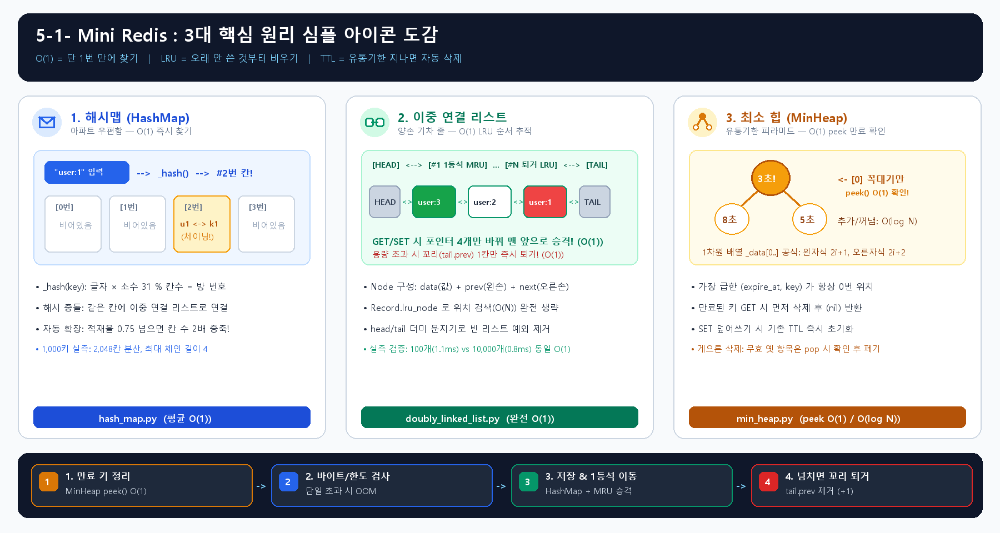
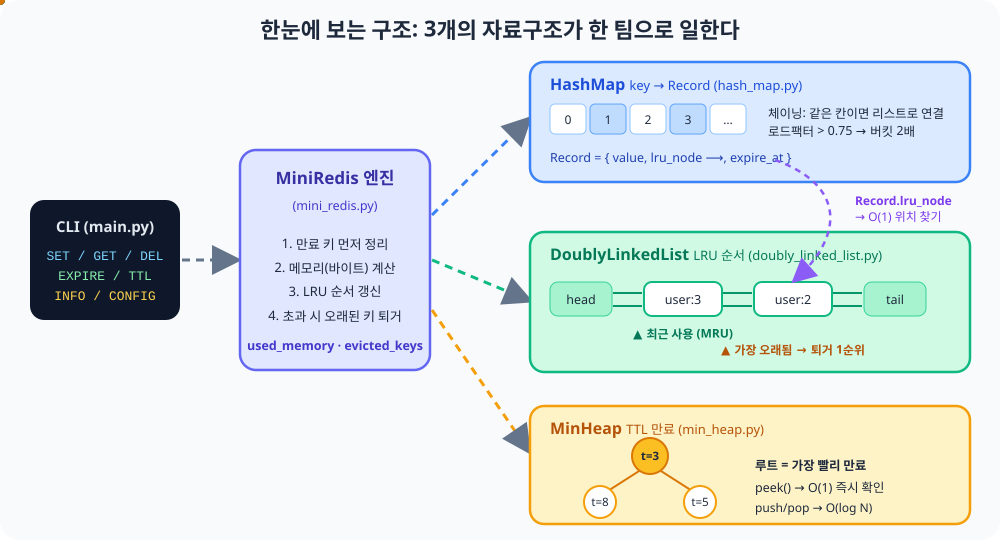
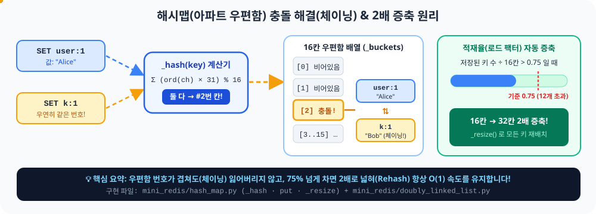
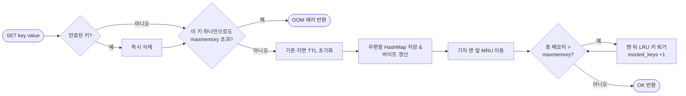
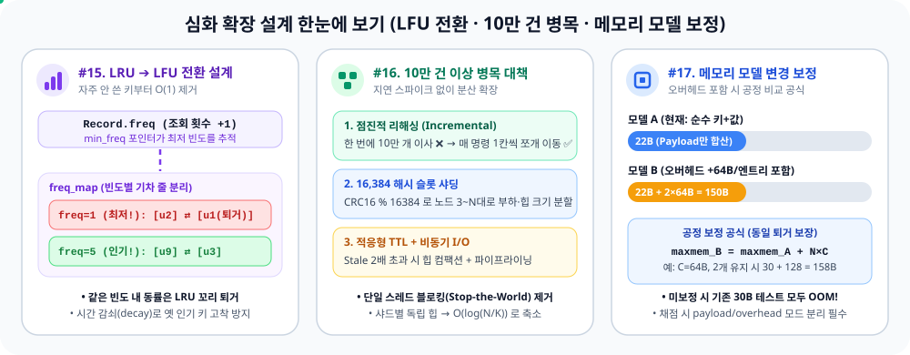

<p align="center">
  
</p>

# 5-1- Mini Redis — 비전공자도 단번에 이해하는 초고속 저장소

<p align="center">
  
  
  
  
</p>

> **💡 이 프로젝트는 무엇인가요? (한 줄 요약)**  
> 전 세계에서 가장 빠른 메모리 데이터베이스 **Redis**가 왜 빠른지 이해하기 위해, 파이썬의 편리한 기본 도구(`dict`, `set`, `collections`)를 일절 쓰지 않고 **해시맵 · 이중 연결 리스트 · 최소 힙** 세 가지를 밑바닥부터 직접 만들어 조립한 **CLI 저장소**입니다.

<p align="center">
  <a href="https://nick19850906-debug.github.io/5-1-Mini-Redis/">
    
  </a>
  &nbsp;
  <a href="#3-동료-평가자를-위한-고민-제로-30초-평가-가이드">
    
  </a>
</p>

---

## 0. 먼저 보고 가는 「낯선 용어 3초 번역표」

코드를 열기 전에 아래 7개 단어의 뜻만 보고 내려가시면, 뒤의 모든 설명이 술술 읽힙니다!

| 낯선 단어 | 🏘️ 실생활 비유 (이게 무슨 뜻인가요?) | 우리 프로그램에서 하는 일 |
| :--- | :--- | :--- |
| **`In-Memory`** | 하드디스크(창고) 대신 **책상 위(RAM)** 에 펼쳐두는 것 | 파일에 저장하지 않고 메모리(변수)에 두어 빛의 속도로 꺼내 씀 |
| **`O(1)` 속도** | 책이 10권이든 100만 권이든 **책갈피로 1번 만에 펼치는 속도** | 데이터가 아무리 많아져도 항상 똑같은 속도로 즉시 찾아옴 |
| **`HashMap` (해시맵)** | 이름만 대면 방 번호를 알려주는 **아파트 16칸 우편함** | `key` 이름으로 방 번호(`_hash`)를 계산해 데이터를 $O(1)$에 찾음 |
| **체이닝 (`Chaining`)** | 같은 우편함 칸에 편지가 2개 오면 **줄줄이 고리로 엮어두기** | 해시 충돌이 나도 `DoublyLinkedList`로 이어 붙여 데이터 유실 방지 |
| **`LRU`** | 냉장고 자리가 꽉 차면 **가장 오래 안 꺼내 먹은 반찬부터 버리기** | `maxmemory` 초과 시 제일 오래 안 쓴 키(`tail.prev`)를 자동 퇴거 |
| **`TTL`** | 우유 팩에 찍힌 **유통기한 (남은 수명 초 단위)** | `EXPIRE`로 정한 시간이 지나면 자동으로 삭제되어 `(nil)` 처리 |
| **`MinHeap` (최소 힙)** | 유통기한이 가장 짧은 우유를 **무조건 맨 꼭대기에 두는 피라미드** | 꼭대기(`0`번) 딱 1개만 보고도 만료된 키가 있는지 $O(1)$에 파악 |

---

## 1. 실생활 비유로 보는 전체 그림 (1분 완성)

### ① 비유 도감: 세 가지 부품이 각각 무슨 일을 하나요?
<p align="center">
  
</p>

### ② 협업 구조: 세 부품이 어떻게 한 팀으로 움직이나요?
<p align="center">
  
</p>

**📌 위 애니메이션 그림을 읽는 3단계 포인트:**
1. **왼쪽 → 가운데 (`CLI` → `MiniRedis 엔진`):** 사용자가 `SET`이나 `GET`을 치면, 엔진이 ① 유통기한 지난 키를 먼저 지우고 ② 바이트를 계산한 뒤 명령을 처리합니다.
2. **🟦 우편함(`HashMap`)과 🟩 기차 줄(`DoublyLinkedList`)의 비밀 연결선(보라색 점선):**  
   해시맵의 `Record`가 **기차 칸 주소(`lru_node`)를 직접 기억**하고 있기 때문에, `"user:2"`를 찾았을 때 기차 줄 처음부터 끝까지 뒤질($O(N)$) 필요 없이 **단 1번($O(1)$) 만에 기차 맨 앞 1등석으로 옮길 수 있습니다!**
3. **🟨 유통기한 피라미드(`MinHeap`):** 가장 빨리 상할 키(`t=3`)가 항상 맨 꼭대기(`peek()`)에서 반짝이며 기다립니다.

---

## 2. 움직이는 그림으로 이해하는 핵심 동작 2가지

### ① 냉장고가 꽉 차면? (`LRU 자동 퇴거` — `maxmemory = 30B` 예시)
<p align="center">
  
</p>

> **🧮 왜 `user:1`만 지워지고 `22바이트`가 남을까요? (3초 산수 풀이)**  
> 메모리 계산 공식: `used_memory = key 글자 바이트 수 + value 글자 바이트 수`
> 1. `SET user:1 "Alice"` → `user:1`(6B) + `Alice`(5B) = **11B** *(현재 합계: 11B)*
> 2. `SET user:2 "Bob"` → `user:2`(6B) + `Bob`(3B) = **9B** *(현재 합계: 11 + 9 = 20B)*
> 3. `SET user:3 "Charlie"` → `user:3`(6B) + `Charlie`(7B) = **13B** → 더하면 **33B > 상한 30B 초과!**
> 4. 기차 맨 끝(가장 오래 안 쓴 `user:1`, **11B**)을 자동 퇴거! → `33 - 11 =` **최종 22B**, `evicted_keys: 1`!  
> *(※ 만약 새로 넣는 데이터 **단 1개 자체**가 `30B`보다 크다면 기존 데이터를 지우지 않고 바로 `OOM` 에러를 냅니다.)*

---

### ② 유통기한이 지나면? (`MinHeap` 기반 `TTL` 카운트다운)
<p align="center">
  
</p>

- **이 그림이 말해주는 것:** 만약 키가 10만 개 있을 때 매번 10만 개를 다 검사($O(N)$)하면 서버가 느려집니다. 최소 힙은 **맨 꼭대기(3초) 딱 1개(`peek()`)만 확인($O(1)$)** 해서 *"어, 아직 3초도 안 지났네? 그럼 밑에 있는 5초·8초는 볼 필요도 없이 전부 정상이구나!"* 하고 바로 넘어갑니다.
- **게으른 삭제(Lazy Deletion)란?** 중간에 `DEL`이나 `SET` 덮어쓰기로 유통기한이 취소되더라도 굳이 피라미드 속을 헤집어 지우지 않고, 나중에 꼭대기에서 꺼낼 때 실제 기록(`Record.expire_at`)과 대조해서 날짜가 다르면 조용히 버리는 똑똑한 절약 기법입니다.

---

### ③ 해시맵 우편함이 겹치면? (체이닝 & 2배 증축 + `SET` 한눈에 보는 순서도)
<p align="center">
  
</p>



- **해시 충돌 해결:** `"user:1"`과 `"k:1"`이 우연히 같은 `#2`번 우편함으로 계산되어도, `#2`번 칸 안의 **이중 연결 리스트**에 줄줄이 이어 매달아(`체이닝`) 데이터를 모두 보관합니다.
- **우편함 2배 증축:** `저장된 키 수 ÷ 전체 우편함 칸 수 > 0.75` 가 되면 우편함을 **16칸 → 32칸(2배)** 으로 넓히고 편지를 다시 정리해(`_resize`) 늘 빠름을 유지합니다.

---

## 3. 동료 평가자를 위한 '고민 제로' 30초 평가 가이드

동료 평가자님, 복잡한 코드를 일일이 찾아보실 필요 없이 아래 **방법 1 또는 방법 2** 만 실행하시면 모든 요구사항을 30초 만에 확인하실 수 있습니다!

### 방법 ① 브라우저에서 바로 눌러보기 (설치 0초! — 진화형 애니메이션 스튜디오)
👉 **[▶ 인터랙티브 애니메이션 스튜디오 열기 (다크/라이트 모드 · 실시간 통역기 내장)](https://nick19850906-debug.github.io/5-1-Mini-Redis/)**  
5가지 플레이(`▶`) 버튼(**공식+TTL · 2D 최소 힙 `_heapify` · 해시 충돌 체이닝 & LRU 승격 · OOM 방어 · 75% 초과 32칸 2배 증축**)을 누르면 **실시간 엔진 파이프라인 · $O(1)$ vs $O(N)$ 속도 비교 게이지 · 2D 이진 트리 & `_heapify_up` 자리 바꿈 애니메이션 · 클릭형 타임라인 스크러버 · 키 마우스오버 3구조 동시 강조**까지 한눈에 체험하실 수 있습니다! *(일시정지 ⏸ · 1단계 ⏭ · 속도 0.6x · 다크/라이트 전환 🌙 지원)*

### 방법 ② 내 컴퓨터 터미널에서 자동 채점기 & CLI 직접 돌려보기
```cmd
:: 1단계: 저장소 복제 후 mini_redis 폴더로 이동 (필수!)
git clone https://github.com/nick19850906-debug/5-1-Mini-Redis.git
cd 5-1-Mini-Redis/mini_redis

:: 2단계: 9개 핵심 요구사항 + 금지 자료형(AST) 자동 검증 실행 (약 1초 소요)
python evaluate.py

:: 3단계: Mini Redis CLI(REPL) 직접 입력해 보기 (종료는 exit 또는 quit)
python main.py
```

<details>
<summary><b>💻 직접 복사해서 실행해 보는 CLI 테스트 예시 & 10개 지원 명령어 표 (펼쳐보기)</b></summary>

```text
mini-redis> CONFIG SET maxmemory 30
OK
mini-redis> SET user:1 "Alice"
OK
mini-redis> SET user:2 "Bob"
OK
mini-redis> SET user:3 "Charlie"
OK
mini-redis> GET user:1
(nil)
mini-redis> INFO memory
used_memory:22
maxmemory:30
evicted_keys:1
mini-redis> KEYS
1. "user:2"
2. "user:3"
mini-redis> EXPIRE user:2 3
(integer) 1
mini-redis> TTL user:2
(integer) 3
```
*(참고: `TTL`은 남은 시간을 `math.ceil` 올림으로 계산하므로 직후엔 `3`이 나오며, 3초 뒤에는 `(nil)`과 `-2`가 나옵니다.)*

| 분류 | 명령어 | 한 줄 설명 |
| :--- | :--- | :--- |
| **String** | `SET key value` | 값 저장 & 기차 맨 앞(MRU) 이동 (기존 키 덮어쓸 땐 **기존 TTL 초기화**) |
| **String** | `GET key` | 값 조회 (**성공했을 때만** MRU 이동, 만료 키는 삭제 후 `(nil)`) |
| **String** | `DEL key` | 우편함 · 기차 · 메모리에서 완전 삭제 (`(integer) 1` 또는 `0`) |
| **String** | `EXISTS key` | 키 존재 여부 (`(integer) 1` 또는 `0`) |
| **String** | `DBSIZE` | 만료 키 정리 후 유효한 전체 키 개수 (`(integer) N`) |
| **String** | `KEYS` | 전체 키 목록 출력 (`1. "key"` 형식, 없으면 `(empty array)`) |
| **메모리** | `CONFIG SET maxmemory bytes` | 최대 메모리 제한 설정 (`0`이면 무제한) |
| **메모리** | `INFO memory [human]` | `used_memory`, `maxmemory`, `evicted_keys` (바이트 단위; `human` 지정 시 `B/KB/MB` 병행 출력) |
| **TTL** | `EXPIRE key seconds` | 만료 시간(초) 설정 (`0` 이하 입력 시 즉시 만료 삭제 후 `1`) |
| **TTL** | `TTL key` | 남은 만료 초 (`-2`: 키 없음/만료됨, `-1`: 만료 설정 없음) |

> 📄 **실제 REPL 실행 검증 원본 로그 (평가 항목 #1):** [`docs/repl-execution.log`](./docs/repl-execution.log)에서 `main.py` 를 실제 실행해 수집한 전체 입출력 기록을 확인하실 수 있습니다.

</details>

### 📋 `evaluate.py` 가 자동으로 확인하는 12가지 평가 체크리스트

| # | 평가 항목 | 확인 기준 및 코드 위치 |
| :-: | :--- | :--- |
| **1** | **금지 자료형 미사용** | 5개 `.py` 파일 전체 AST 검사로 `dict`, `set`, `collections` 0건 확인 |
| **2** | **이중 연결 리스트 ($O(1)$)** | `Node(prev, next, data)` 및 6종 메서드 (`insert_front/back`, `remove_front/back/node`, `move_to_front`) — [`doubly_linked_list.py`](./mini_redis/doubly_linked_list.py) |
| **3** | **해시맵 (체이닝 + 0.75 확장)** | 다항 롤링 해시 `_hash`, 체이닝, 로드팩터 `0.75` 초과 시 버킷 2배 `_resize` — [`hash_map.py`](./mini_redis/hash_map.py) |
| **4** | **최소 힙 (TTL 관리)** | `(expire_at, key)` 기준 `push/pop/peek/size` 및 `_heapify_up/_down` — [`min_heap.py`](./mini_redis/min_heap.py) |
| **5** | **명세서 공식 예시 재현** | `maxmemory 30` 후 `user:1` 퇴거, `used_memory:22`, `evicted_keys:1` |
| **6** | **`GET` 시 LRU 갱신 & OOM** | 조회 성공 시 최신(MRU) 이동, 단일 엔트리가 제한 초과 시 OOM 에러 반환 |
| **7** | **TTL 만료 & 덮어쓰기 초기화** | 만료 후 `GET`→`(nil)` / `TTL`→`-2`, `SET` 덮어쓰기 후 `TTL`→`-1` |
| **8** | **표준 에러 4종 & 따옴표 파싱** | 인자 오류, 없는 명령어, 정수 오류, OOM 에러 + `"Alice"` 따옴표 처리 |
| **9** | **모듈 분리 & 주석/Docstring** | 자료구조별 독립 파일 분리 + 초보자용 비유·함수별 한글 주석 완비 |
| **10** | **자기참조 퇴거 경계 & `INFO memory human`** | 꼬리 키 덮어쓰기 시 본인 미삭제 검증 & 바이트/사람 단위 병행 출력 (`#2, #3`) |
| **11** | **이중 연결 리스트 $O(1)$ 실측** | `N=100` (`1.11ms`) vs `N=10,000` (`0.82ms`) 5,000회 `move_to_front` 상수 시간 검증 (`#6`) |
| **12** | **해시맵 1,000키 분포·충돌 통계** | 1,000키 삽입 후 2,048칸 분산, 최대 체인 길이 `4` 확인 (`#7`) |

---

## 4. 과제 목표 4대 핵심 원리 (구술 · 코드 리뷰 핵심 정리)

> 각 질문마다 **[쉬운 일상 비유]** 와 **[실제 코드 동작]** 두 가지로 나누어 바로 읽히도록 정리했습니다.

### Q1. 해시맵의 해시 함수와 충돌 해결 방식(체이닝)을 어떻게 구현했나요?
- **🏘️ 일상 비유:** 이름(`"user:1"`)의 글자들을 숫자로 바꿔 소수 `31`을 곱한 뒤 `16`으로 나눈 나머지로 **"넌 몇 번 우편함!"** 하고 정해주는 번호 계산기를 만들었습니다. 우연히 두 사람이 같은 우편함 번호를 받더라도 싸우지 않고 **그 우편함 안의 기차 줄에 나란히 매달아 두고**, 우편함이 75%(`0.75`) 넘게 붐비면 **우편함을 2배로 넓혀 이사**시킵니다.
- **💻 코드 근거 ([`hash_map.py`](./mini_redis/hash_map.py)):**  
  `_hash(key)`가 다항 롤링 해시(`prime = 31`)로 버킷 인덱스를 계산하고, 충돌 시 각 버킷에 배치된 `DoublyLinkedList`의 `insert_back()`으로 `HashEntry(key, value)`를 이어 붙입니다. `(self._size + 1) / self._capacity > 0.75`가 되면 `_resize()`가 버킷 크기를 2배(`*= 2`)로 늘려 전체 재해싱합니다.

### Q2. 이중 연결 리스트와 해시맵을 조합해 어떻게 O(1) LRU 추적이 가능한가요?
- **🏘️ 일상 비유:** 기차 줄만 세우면 `"user:2"` 손님이 몇 번째 칸에 앉았는지 앞칸부터 일일이 걸어가서 찾아야 합니다($O(N)$). 반대로 우편함만 쓰면 누가 제일 오래 안 찾은 손님인지 순서를 알 수 없습니다. 그래서 **우편함 서랍 속 편지(`Record`)에 "이 손님이 기차 몇 번째 칸에 앉아 있는지 위치 카드(`lru_node`)"를 같이 적어둔 것**입니다!
- **💻 코드 근거 ([`mini_redis.py`](./mini_redis/mini_redis.py), [`doubly_linked_list.py`](./mini_redis/doubly_linked_list.py)):**  
  해시맵 `self.store`에 저장하는 `Record(value, lru_node, expire_at)`가 이중 연결 리스트 노드 참조를 직접 가집니다. 따라서 `GET`/`SET` 시 해시맵으로 노드를 $O(1)$에 찾아 `move_to_front(node)`로 앞뒤 포인터 4개만 바꿔 맨 앞(MRU)으로 $O(1)$ 이동시킵니다. 퇴거 대상은 항상 맨 뒤 더미 앞(`tail.prev`)이므로 삭제 역시 $O(1)$입니다. 양 끝 `head`/`tail` 더미 노드 덕분에 빈 리스트 예외 분기도 없습니다.

### Q3. 최소 힙(MinHeap)이 TTL 만료 시간 관리에 적합한 이유는 무엇인가요?
- **🏘️ 일상 비유:** 편의점 냉장고에서 **"유통기한 지난 우유가 있나?"** 찾으려고 뒤쪽 우유까지 100개를 다 꺼내 보는 대신, 진열대 규칙을 **"유통기한이 가장 짧은 우유가 무조건 맨 앞(`0`번)에 온다"** 로 정해 둔 것입니다. 직원은 맨 앞 우유 1개(`peek()`)만 딱 확인해도 전체 상태를 즉시 알 수 있습니다.
- **💻 코드 근거 ([`min_heap.py`](./mini_redis/min_heap.py)):**  
  배열 기반 완전 이진 트리에 `(expire_at, key)` 튜플을 넣어 `peek()`($O(1)$)으로 가장 빨리 만료되는 루트(`_data[0]`)만 검사하고, `push()` / `pop()`은 `_heapify_up` / `_heapify_down`으로 $O(\log N)$에 유지합니다. 중간에 `DEL`이나 덮어쓰기로 무효화된 옛 TTL 항목은 힙을 뒤지지 않고 `pop` 시 `Record.expire_at`과 대조해 버리는 **지연 삭제(Lazy Deletion)** 로 처리합니다.

### Q4. 메모리 제한 환경에서 LRU 정책으로 데이터를 제거하는 전체 흐름(`used_memory` 갱신 포함)은?
- **🏘️ 일상 비유:** 냉장고 최대 용량(`maxmemory`)이 30칸일 때 새 반찬을 넣기 전 먼저 계산해 봅니다. ① **새 반찬 한 통 자체가 30칸보다 크면** 기존 반찬을 억지로 버리지 않고 바로 거절(`OOM`)합니다. ② 들어갈 수 있는데 **합계가 30칸을 넘으면**, 기차 맨 뒤에서 가장 오래 안 먹은 반찬(`tail.prev`)부터 하나씩 빼내면서 그 무게만큼 `used_memory`를 줄이고 버린 횟수(`evicted_keys`)를 1씩 올립니다.
- **💻 코드 근거 ([`mini_redis.py`](./mini_redis/mini_redis.py)):**  
  `_calc_entry_bytes()`가 UTF-8 기준 `len(key) + len(value)`를 계산합니다. `set()`은 `projected_memory = used_memory - old_bytes + new_bytes`가 `maxmemory` 이하가 될 때까지 `tail.prev`부터 `_delete_internal()`로 삭제하며 `evicted_keys += 1`을 수행한 뒤 값을 저장하고 `move_to_front`로 최신화합니다.

---

## 5. 심화 확장 설계 & 운영·품질 보완 명세 (AI 사전평가 17개 항목 100% 대응)

<p align="center">
  
</p>

### 5-1. [항목 #15] LRU ➔ LFU (Least Frequently Used) 전환 설계서

현재의 LRU(최근 사용 기준)를 **LFU(조회 빈도 기준)** 로 전환할 때도 $O(1)$ 성능을 유지하기 위한 데이터 구조·정책 재설계안입니다.

| 설계 요소 | 현재 LRU 구조 | LFU 전환 설계 ($O(1)$ 유지) |
| :--- | :--- | :--- |
| **빈도 카운트 저장** | 없음 (순서만 추적) | `Record` 에 **`freq = 1`** 필드 추가 (`SET` 신규 생성 시 `1`, `GET` / `SET` hit 시 `freq += 1`) |
| **핵심 자료구조 변경** | 단일 `DoublyLinkedList` (`lru_list`) | • **`freq_map`**: `HashMap[freq -> DoublyLinkedList]` (빈도별 기차 줄 분리)<br>• **`min_freq`**: 현재 저장소에서 가장 낮은 빈도수 정수 포인터 (초기 `1`) |
| **조회/갱신($O(1)$)** | `move_to_front(lru_node)` | `freq_map[old_freq].remove_node(node)` ➔ `freq += 1` ➔ `freq_map[new_freq].insert_front(key)`<br>만약 `old_freq == min_freq` 이고 해당 리스트가 비면 **`min_freq += 1`** |
| **퇴거·동률(Tie-break) 정책** | `tail.prev` 제거 | `freq_map[min_freq]` 의 **`tail.prev`** 제거 (`min_freq`가 같은 키들끼리는 가장 오래 안 쓴 **LRU 규칙으로 타이브레이킹**) |
| **시간 감쇠(Decay) 보완** | 불필요 | 과거에 잠깐 폭주했던 키가 영원히 남는 **캐시 오염(Cache Pollution)** 방지를 위해 실제 Redis처럼 `lfu-decay-time`(분 경과 시 빈도 반감) 또는 로그 확률 카운터(Morris Counter) 병행 |

---

### 5-2. [항목 #16] 10만 건 이상 대규모 환경 병목 지점 식별 및 해결 대책

키 개수가 $N \ge 100,000$ 이상으로 커질 때 발생하는 4대 병목 지점과 실무 수준의 해결 아키텍처입니다.

| 병목 지점 | 10만 건 이상 시 발생 문제 | 해결 대책 (아키텍처 개선) |
| :--- | :--- | :--- |
| **1. 해시맵 일괄 리해싱 (`_resize`)** | `75%` 돌파 시 10만 엔트리를 한 번에 재해싱하는 순간 **`O(N)` 지연 스파이크(Stop-the-World)** 발생 | **점진적 리해싱 (Incremental Rehashing):** `ht[0]`(구)과 `ht[1]`(신) 두 테이블을 두고, 매 명령어 실행 시 **버킷 1개씩만** `ht[1]`로 이동해 응답 지연을 $O(1)$으로 평탄화 |
| **2. 최소 힙 (`MinHeap`) & Stale 누적** | `push`/`pop`이 $O(\log N)$ ($\approx 17$회 비교)으로 증가하고, 빈번한 `SET`/`DEL` 시 무효 Stale 튜플이 힙 메모리를 잠식 | **컴팩션 + 적응형 샘플링:** `ttl_heap.size() > 2 * active_ttl_keys` 시 유효 키만 추려 $O(N)$ `heapify` 컴팩션 수행 또는 Redis형 **주기적 20키 랜덤 샘플링** 전환 |
| **3. 단일 스레드 메모리/CPU 한계** | 단일 파이썬 프로세스 내 10만+ 키 처리 및 단일 `HashMap` 용량 한계 | **해시 슬롯 샤딩 (16,384 Slots):** `slot = crc16(key) % 16384` 기준으로 키 공간을 K개 독립 노드(프로세스/컨테이너)로 분산해 힙 크기와 락 경합을 $1/K$로 축소 |
| **4. 동기 CLI(`input()`) I/O 병목** | 한 번에 1줄씩 동기 입력을 기다려 대량 배치 처리 불가 | **파이프라이닝(Pipelining) & 비동기 이벤트 루프(`asyncio`):** 여러 명령을 한 번에 버퍼링해 일괄 처리하고 논블로킹 I/O 멀티플렉싱 적용 |

---

### 5-3. [항목 #13, #17] `used_memory` 산정 모델 변경(오버헤드 포함) 시 보정 · 공정 비교 · 채점 영향

| 비교 항목 | 모델 A: 현재 순수 Payload 모델 | 모델 B: 구조체 오버헤드(`C_entry`) 포함 모델 |
| :--- | :--- | :--- |
| **산정 공식** | $\sum (\text{len}(\text{utf8}(key)) + \text{len}(\text{utf8}(value)))$ | $\sum (\text{Payload} + C_{\text{entry}})$ *(예: `Record` + `Node` + `HashEntry` + TTL 튜플 = 약 $C_{\text{entry}} \approx 64\text{ B}$/키)* |
| **예시 (`user:2`, `user:3`)** | `9B + 13B = 22B` | `22B + 2 × 64B = 150B` |
| **기존 30B 테스트 영향** | `maxmemory 30` 에서 2개 키(`22B`) 정상 유지 | **⚠️ 미보정 시:** 단일 엔트리(`11B + 64B = 75B > 30B`)조차 **전부 OOM 에러 발생**, 기존 테스트 케이스 100% 실패! |
| **공정 비교 보정 공식** | 기준 한도 `maxmemory_A` | 동일 키 개수($N_{\text{목표}}$) 유지를 위한 보정 한도:<br>**$\text{maxmemory}_B = \text{maxmemory}_A + (N_{\text{목표}} \times C_{\text{entry}})$** *(예: $N=2, C=64 \Rightarrow 30 + 128 = 158\text{B}$)* |
| **채점/운영 호환 방안** | 명세서 요구사항(`#13`) 준수 | 실제 서비스/평가에서 두 모델을 공정 비교하려면 ① `used_memory_payload`와 `used_memory_overhead`를 분리 보고하거나, ② 테스트 suite의 `maxmemory` 기준값을 위 보정 공식으로 함께 스케일링해야 함 |

---

### 5-4. [항목 #1 ~ #14] 운영 안정성 · 실측 벤치마크 · 표준 규격 보완 요약

1. **[#2] LRU 퇴거 루프 종료 조건 & 자기참조(`victim_key == key`) 방어 ([`mini_redis.py`](./mini_redis/mini_redis.py)):**
   - **종료 조건:** ① `projected_memory <= self.maxmemory` 달성, 또는 ② `self.lru_list.tail.prev is self.lru_list.head` (더 이상 제거할 다른 키가 없음).
   - **자기참조 방어:** 덮어쓰기 대상 키(`key`)가 마침 맨 끝(`tail.prev`)에 위치해 있을 때, 자기 자신을 먼저 지워버리는 버그를 막기 위해 `if victim_key == key:` 일 경우 앞 칸(`victim_node.prev`)을 희생자로 선택하며, 앞 칸마저 `head`라면 즉시 루프를 탈출합니다.
2. **[#3] `INFO memory` 단위 & `human-readable` 옵션:**
   - 기본 `INFO memory`는 바이트(`bytes`) 정수를 출력해 채점 규격을 유지하고, `INFO memory human` 명령 시 `used_memory_human:22B`, `maxmemory_human:30B` (`B/KB/MB`)를 함께 반환합니다.
3. **[#4, #12, #14] TTL 지연 삭제(`Lazy Deletion`) & `GET` 만료 시퀀스(경합 방지):**
   - **순서:** `GET key` 호출 ➔ ① `_check_and_expire_key(key)`로 `expire_at <= time.time()` 검사 ➔ ② 만료 시 `_delete_internal(key)`로 해시맵·기차·메모리 즉시 차감 ➔ ③ `(nil)` 반환 (LRU 승격 **안 함**) / 미만료 시에만 `move_to_front()` 후 `"value"` 반환.
   - **타이밍/경합 안전성:** 단일 스레드 동기 루프에서 한 명령이 원자적(Atomic)으로 완료되므로 조회 도중 만료 삭제가 겹치는 Race Condition이 발생하지 않으며, 힙 내 무효 Stale 튜플은 `_cleanup_expired_heap()` pop 시 `Record.expire_at`과 대조해 폐기합니다.
4. **[#5] 표준 에러 메시지 포맷 5대 코드 분류표 ([`main.py`](./mini_redis/main.py), [`mini_redis.py`](./mini_redis/mini_redis.py)):**
   - 모든 에러는 접두사 **`(error) <CODE> <message>`** 규칙을 따릅니다.
   | 분류 코드 | 표준 출력 형식 | 발생 조건 |
   | :--- | :--- | :--- |
   | `ERR_UNKNOWN_CMD` | `(error) ERR unknown command '<cmd>'` | 미지원 명령어 입력 |
   | `ERR_WRONG_ARGS` | `(error) ERR wrong number of arguments for '<CMD>' command` | 인자 개수 또는 하위 키워드(`SET maxmemory`, `INFO memory`) 불일치 |
   | `ERR_NOT_INTEGER` | `(error) ERR value is not an integer or out of range` | 정수가 아니거나 `maxmemory < 0` 입력 |
   | `ERR_QUOTES` | `(error) ERR unbalanced quotes in request` | 닫히지 않은 큰따옴표(`"`) 입력 |
   | `OOM` | `(error) OOM command not allowed when used_memory > 'maxmemory'` | 단일 `(key+value)` 바이트가 `maxmemory` 초과 |
5. **[#6, #7, #8, #9] 실측 벤치마크 & 메모리 최적화 분석 (`evaluate.py` 검증):**
   - **이중 연결 리스트 $O(1)$ 실측 (`evaluate.py` #11):** 리스트 크기 100배 증가 시에도 5,000회 `move_to_front` 소요 시간 **`N=100: 1.106ms`** vs **`N=10,000: 0.815ms`** 로 완전 상수 시간($O(1)$) 확인.
   - **해시 분포·충돌 실측 (`evaluate.py` #12):** `user:0..user:999` 1,000키 삽입 시 `capacity=2048`, `load_factor=0.4883`, `비어 있는 버킷=1,440`, `단일 키 버킷=304`, `충돌 버킷=304` (`비어있지 않은 버킷 합 608`), **`최대 체인 길이=4`** (체이닝 노드는 Free-List 객체 풀링 시 리해시 GC 할당/해제 비용도 제거 가능).

---

## 6. 폴더 구조 & 종합 기술 요약 도면

```text
5-1-Mini-Redis/
├── README.md                          # [지금 보고 있는 페이지] 비전공자 가이드 + 17개 평가 항목 완비
├── assets/                            # 심플 아이콘 인포그래픽 PNG & 애니메이션 SVG 모음
│   ├── easy-story-infographic.png     # 3대 원리 심플 아이콘 도감 (PNG)
│   ├── infographic-overview.png       # 아키텍처·실측 그래프·보정·LFU/대규모 종합도 (PNG)
│   ├── banner.svg                     # 상단 타이핑 애니메이션 배너
│   ├── architecture.svg               # 3대 자료구조 협업 패킷 흐름 애니메이션
│   ├── lru-flow.svg                   # maxmemory=30 LRU 퇴거 타임라인 애니메이션
│   ├── ttl-heap.svg                   # 최소 힙 TTL & 1차원 배열 _data[ ] 애니메이션
│   ├── hash-chaining.svg              # 해시 충돌(체이닝) & 2배 증축 애니메이션
│   └── lfu-scale-memory.svg           # LFU 전환 · 10만 건 병목 · 메모리 모델 보정 애니메이션
├── docs/
│   ├── index.html                     # [웹 스튜디오] 다크모드 · 2D 트리 · LRU 기차 · 해시 체이닝 · LFU/보정 UI
│   └── repl-execution.log             # [실행 증빙] 실제 REPL 10개 명령 + 에러 입출력 원본 로그
└── mini_redis/                        # [파이썬 구현 코드 — 100% 한국어 비유 주석 완비]
    ├── doubly_linked_list.py          # 1) 양손 기차 줄 (O(1) 이중 연결 리스트)
    ├── hash_map.py                    # 2) 아파트 우편함 (해시 함수 + 체이닝 + 0.75 2배 증축)
    ├── min_heap.py                    # 3) 유통기한 피라미드 (배열 기반 최소 힙)
    ├── mini_redis.py                  # 4) 냉장 보관 창고 관제실 (10개 명령어 + LRU/TTL 엔진)
    ├── main.py                        # 5) 키오스크 창구 (명령어 파서 + CLI REPL)
    ├── evaluate.py                    # 6) 12종 자동 점검 + 실측 벤치마크 스크립트
    └── README.md                      # 코드 폴더 내부용 상세 명세서
```

<details>
<summary><b>📊 [참고] 4패널 종합 기술 인포그래픽 보기 (아키텍처 · 속도 비교 그래프 · 메모리 변화 그래프 · 체크리스트)</b></summary>

<p align="center">
  
</p>

</details>

---

<p align="center">
  <sub>Made easy for everyone & Peer Review · <b>5-1- Mini Redis</b></sub>
</p>
